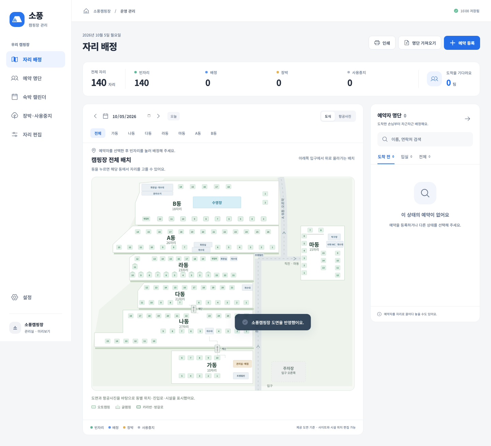

# 소풍캠핑장

관리실 PC 한 대에서 예약자 검색, 자리 배정, 입퇴실과 장박을 관리하는 설치형 프로그램의 첫 동작 버전입니다. 토스의 단순한 화면 구성을 참고한 독립적인 디자인이며 토스 공식 제품은 아닙니다.



## 실행

- **Windows 설치 파일:** [Sopung-Camp-Setup-0.1.15.exe](release/Sopung-Camp-Setup-0.1.15.exe). x64·32비트 통합 설치 파일입니다. SHA-256은 [확인 파일](release/Sopung-Camp-Setup-0.1.15.exe.sha256)을 참고하세요.
- **현재 Mac에서 실행:** 프로젝트 폴더의 [소풍캠핑장 실행 (Mac).command](<소풍캠핑장 실행 (Mac).command>)를 더블클릭합니다. 현재 빌드와 설치된 실행기를 여는 바로가기이므로 프로젝트 폴더 안에 두고 사용합니다. 개발 코드 변경 후에는 `npm run build`로 다시 빌드하거나 터미널에서 `npm run desktop`을 실행합니다.
- **현재 PC의 화면 미리보기:** [http://127.0.0.1:5173](http://127.0.0.1:5173). 개발 서버가 실행 중이어야 합니다.
- 설치 앱은 첫 실행 시 PIN 또는 비밀번호를 설정하고 **지금 Mac에 저장된 7개 동·140자리·15시설의 편집 배치를 자동 준비·저장**합니다(0.1.15, 2026-11-06 추출). 마7·마8의 저장된 위치도 포함합니다. 예약·배정·장박은 비워 둡니다.
- **이미 설치한 Windows:** 새 설치 파일로 업데이트한 뒤 **설정 → 저장된 자리배치 적용 → 확인**을 누르면 현재 데이터를 먼저 백업하고 같은 배치를 적용합니다. 기존 예약·배정·장박·자리 ID는 유지합니다. 기존 데이터를 자동으로 덮어쓰지는 않습니다. 적용 이후의 위치 편집도 재실행·업데이트 시 유지합니다. [배치 포함 방식과 사용법](docs/bundled-layout-2026-11-06.md).
- 이번 원본에는 항공사진이 등록되어 있지 않아 설치 배치에 사진은 없습니다. 예약·사진을 포함한 전체 운영 자료를 다른 PC로 옮길 때는 **백업 파일 내보내기 → Windows에서 백업 폴더 복원**을 사용합니다.
- 브라우저 미리보기는 **체험 데이터**로 시작합니다. 예시 자리 수·배치·손님·장박은 실제 현황이 아닙니다. 설치 앱과 브라우저 데이터는 서로 공유하지 않습니다.
- 설치 앱은 왼쪽 아래 **프로그램 종료**로 닫습니다. 잠금 화면에도 종료 버튼이 있으며 저장 중에는 잠시 비활성화됩니다.

Windows 8·8.1·10·11을 지원 목표로 빌드했지만, 현재 Mac 환경이므로 **Windows에서의 실제 설치·실행은 미검증**입니다. 설치 파일은 개발용이며 코드 서명 인증서가 적용되지 않았습니다. Windows 8 호환을 위해 사용한 Electron 22의 공급자 보안 지원이 종료되어 있어 실제 운영 배포 전 검토가 필요합니다. [호환성과 검증 범위](docs/windows-compatibility.md)를 참고하세요.

## 사용 흐름

1. **배치도 적용·편집:** 도면 적용 후 **자리 편집 → 동별 배치 → 동 선택**에서 사이트 또는 시설 위치를 끌어 옮기면 자동 저장됩니다. 방향키 이동·격자 정렬·되돌리기를 지원하고 배정 화면과 인쇄에 반영합니다. 기존 손님 배정은 유지합니다. [도면·시설 편집 안내](docs/site-plan-2026-10-05.md)를 참고하세요. 항공사진 위치는 별도로 지정합니다.
2. **예약 등록 / 명단 가져오기:** 직접 예약을 입력하거나 CSV·XLSX의 열을 연결해 미리보기를 확인합니다. 가져오기 창에서 CSV 양식도 받을 수 있습니다.
3. **자리 배정:** **전체 배치 → 원하는 동 클릭 → 동 상세에서 빈자리 선택** 순서입니다. ‘전체 배치로’를 눌러 다른 동을 확인해도 선택한 손님과 날짜는 유지됩니다. 입실일 당일에는 오후 2시 전에도 배정과 입실을 함께 처리할 수 있고 지정 객실도 조기 입실할 수 있습니다. 상세 화면에서 손님을 자리로 끌어 놓을 수도 있습니다. 숙박 유형과 실제 입실부터 퇴실까지 전체 기간의 겹침을 검사합니다.
4. **예약 상세:** 즉시 이동·이동 예약, 숙박 연장, 레이트 체크아웃, 추가요금·결제·차량·메모, 조기 퇴실·노쇼·취소를 관리합니다. 예정 이동은 ‘이동 완료’를 눌러야 출발지를 비웁니다. 명단에서 자동 배치된 카라반·방갈로는 입실 전에도 **객실 변경·배정 해제·객실 지정**을 할 수 있고, 이때 입실 처리는 하지 않습니다.
5. **장박·사용중지:** 자리, 이름, 연락처, 기간을 등록합니다. 기존 예약과 겹치면 등록을 막습니다. 사용중지는 시작 시각을 고를 수 있어(오늘은 지금, 다른 날은 0시가 기본) 아침에 퇴실한 자리도 지금부터 막을 수 있습니다. 장박은 기존대로 14시에 시작합니다.
6. **예약 명단 / 지난 기록:** 검색과 상태 필터는 전체 예약에 적용하고 표는 100건씩 나눠 보여 줍니다. 지도 옆 예약자 명단도 100명씩 나뉘며 전체 인원과 쪽을 표시합니다. 지난 연도 기록을 보관했다면 ‘보관 기록에서 찾기’로 이름·연락처·차량·메모를 검색하고 읽기 전용 상세와 변경 기록을 볼 수 있습니다.
7. **숙박 캘린더 / 인쇄:** 항상 **월요일부터 일요일** 순서로 표시합니다. 이전·다음 주와 ‘이번 주’에서도 같은 순서를 유지합니다. 크게 표시한 요일과 주말·오늘 구분으로 현황을 확인하며 날짜별 자리 명단과 동별 도식을 인쇄할 수 있습니다.

| 색 | 의미 |
|---|---|
| 초록 | 빈자리 |
| 파랑 | 배정·입실·이동 예정 |
| 주황 | 장박 |
| 회색 | 사용중지 |

색만으로 정보를 전달하지 않고 상태 이름과 범례를 함께 제공합니다. 빈자리 표시와 별개로 실제 배정 시 전체 숙박 기간의 충돌을 다시 확인합니다.

라동 글램핑 1–11과 방갈로 A, B동 방갈로 B·카라반 3–12의 럭셔리·골든·스페셜3·스파3를 구별합니다. 전체 배치는 가→나→다→라→A→B 순서이며 마동은 라동 오른쪽 도로 건너편에 표시합니다. 전체 지도에도 사이트 줄·시설·상태를 표시하고 나동의 왼쪽 꺾임, 짧은 가동, A동의 줄 시작 위치와 세로형 마동을 사진에 맞춰 표현했습니다.

라동 트램펄린은 내부 사이트 구역이 아닌 오른쪽으로 꺾이는 모서리 바로 위쪽에 있으며 가동 트램펄린과 별도 시설입니다. 마7·마8은 얇은 단차 선으로 표시합니다. 상세·편집에서 해당 자리 위치를 바꾸면 선도 따라갑니다. 자동 크기 맞춤은 화면 표시 전에 계산하고 스크롤바로 폭이 바뀌는 현상을 줄였습니다.

## 캠핏 로그인과 예약 동기화

현재 예약 경로는 캠핏만입니다. **Windows 설치 후 설정 → 캠핏 로그인**에서 공식 캠지기센터에 직접 로그인할 수 있도록 별도 창을 준비했습니다. 아이디·비밀번호를 대화나 프로그램 설정란에 전달할 필요가 없습니다. 앱 시작 때 강제로 로그인 화면을 열지는 않습니다.

**캠핏 동기화** 버튼을 추가했습니다. 캠핏 예약 목록에 CSV·XLSX 내보내기가 있으면 첫 파일의 열·상품 유형·예약 상태를 한 번 확인해 연결합니다. 이후 버튼을 누르면 저장한 예약 화면의 내보내기 버튼을 찾아 파일을 받아 반영합니다. 로그인이 만료되면 캠핏 창에서 다시 로그인합니다. 중복 예약은 추가하지 않고 취소·날짜 변경은 사장님 확인 전까지 배정을 유지합니다. 캠핏 화면의 조회 조건에 포함된 예약만 가져오며 목록에서 빠진 예약을 삭제하지 않습니다.

로그인 후에도 첫 내보내기 파일과 열 연결이 필요합니다. 0.1.14는 일반 다운로드 링크도 인식하고, 대기 실패를 첫 연결·화면 불일치·버튼 없음/중복·클릭 후 파일 없음으로 구분합니다. [Windows 설치 후 조사](docs/windows-install-investigation-2026-10-10.md).

**사용자는 Windows에서 캠핏 로그인과 엑셀 내려받기까지 했으며, 2026-11-06에 확장자는 `.xlsx`라고 확인했습니다. 실제 열과 앱의 수신·저장 완료는 확인 중입니다.** 프로그램의 파일 수신·열 연결·반복 동기화는 모의 예약 화면으로 검증했으며 실제 공급자 파일의 수신·반영은 Windows에서 추가 확인해야 합니다. 기존 **명단 가져오기**도 유지했습니다. [첫 연결 방법·검증 범위](docs/camfit-sync-2026-10-06.md).

로그인하면 자동으로 연결·내려받기를 하도록 요청해 **연결 시작 → 직접 로그인 → 예약 화면 이동 → XLSX 내보내기 → 검사·저장** 흐름을 설계했습니다. **0.1.15는 이 자동 연결을 구현한 버전은 아닙니다.** 실제 화면·열 연결 확인이 남아 있습니다. [자동 연결 설계와 필요한 확인](docs/camfit-auto-connect-2026-11-06.md).

## 저장·백업·잠금

- Windows 데이터 위치: 기본 `%APPDATA%\Sopung Camp\camp-data.json`. 실제 위치는 설정 화면에 표시합니다. 설치 폴더와 분리되어 업데이트·제거 시 데이터를 자동 삭제하지 않습니다.
- 원본 파일을 임시 파일에 기록한 뒤 교체하고 직전 저장본도 보관합니다. 일일 백업 기본 위치는 문서 폴더의 `Sopung Camp Backups`이며 다른 폴더로 변경할 수 있습니다.
- 앱 실행 중 매일 백업합니다. 꺼져 있던 기간은 다음 실행 시 백업을 생성합니다. 앱 종료 중에 작업 스케줄러를 실행하는 방식은 아닙니다. 보관된 백업은 임의로 자동 삭제하지 않습니다.
- 백업 내보내기·복원이 있으며 복원 전 데이터도 별도 보관합니다. 손상된 저장 파일을 읽지 못하면 자동으로 비우지 않고 복원 화면을 표시합니다.
- 저장 파일은 UTF-8 기준 16MB까지 지원합니다. 설정 화면에서 현재 크기와 한도를 보여 주고, 75%를 넘으면 모든 화면에 계속 안내합니다. 복원 전에 잘못된 날짜·시각·중복 배정·자리 기간 중첩을 검사합니다. 자동 백업 실패는 저장 성공과 구분해 계속 표시합니다. 같은 이름의 폴더나 손상된 파일이 백업 자리에 있으면 덮어쓰거나 성공으로 기록하지 않습니다.
- **지난 연도 기록 보관(0.1.13):** 설정 → ‘지난 연도 기록 보관’을 누르면 올해 이전에 끝난 퇴실·노쇼·취소 예약과 그 배정·변경 기록을 데이터 폴더의 `archive` 폴더에 연도별 파일로 옮깁니다. 기록은 지우지 않으며 예약 명단의 ‘보관 기록에서 찾기’로 계속 볼 수 있습니다. 도착 전·입실·이동 예정 예약, 확인 전 원본 변경, 장박·사용중지는 옮기지 않습니다. 다시 가져온 명단에 보관된 예약이 있어도 새로 만들지 않습니다.
- **항공사진 파일:** 설치 앱에서 새로 올린 항공사진은 데이터 폴더의 `assets` 폴더에 따로 저장하고 저장 파일에는 참조만 둡니다. 예전처럼 저장 파일 안에 들어 있는 사진은 자리 편집 → 항공사진 위치의 ‘사진을 별도 파일로 옮기기’로 같은 사진·좌표를 유지한 채 옮길 수 있습니다. 사진을 바꿔도 기존 자리 위치는 지우지 않습니다.
- **백업 폴더 전체를 함께 보관하세요.** 보관 기록·사진 파일이 있으면 백업 폴더의 `archive`·`assets` 폴더에 사본이 함께 생깁니다. 본 백업 JSON만 옮기면 보관 기록이 빠지므로 복원할 수 없습니다. 이 경우 설정의 ‘백업 폴더에서 복원’으로 백업 폴더 안의 JSON을 고르면 같은 폴더의 파일까지 확인해 복원합니다. 내용이 다른 현재 보관·사진 파일은 지우지 않고 `replaced-<시각>` 폴더로 옮겨 둡니다. ‘백업 파일 내보내기’는 보관·사진 파일이 있으면 폴더째 내보냅니다. 예전 단일 백업 파일도 그대로 복원할 수 있습니다.
- PIN·비밀번호는 salt가 포함된 PBKDF2 검증값으로 별도 보관합니다. 잠금은 앱 접근 제어이며 예약 파일 자체를 암호화하는 기능은 아닙니다. 잠금 원문은 예약 백업에 포함되지 않습니다.
- 브라우저 미리보기는 localStorage와 수동 파일 백업을 사용합니다. 브라우저 저장 공간 부족 시 오류를 표시하고 저장 성공으로 보고하지 않습니다.

## 실제 자료를 받아 확인할 부분

- 도면 반영 이후 현장 변경 사항, 직접 등록할 장박·사용중지 명단과 기간. 도면의 무번호 추가 칸은 사이트로 등록하지 않았습니다.
- 캠핏의 실제 내보내기 파일. 현재 파서는 사용자가 연결한 열을 읽는 범용 방식이며 공급자 전용 연동을 검증한 상태가 아닙니다. 한 행이 여러 자리라면 단위번호로 나눈 행이 필요합니다.
- 원본 예약번호·단위번호·경로로 중복을 식별합니다. 다른 경로에 유입된 같은 예약은 자동 병합하지 않고 중복 후보를 알립니다. 누락 행을 취소로 추정하지 않습니다.
- 가져온 취소·날짜 변경은 확인 목록에 보류합니다. 현장 메모·차량·연장·노쇼 등은 다시 불러왔다고 덮어쓰지 않습니다. 이름·연락처·유형·인원 변경은 알림으로 안내하며 자동 갱신하지 않습니다.
- 레이트 종료 시각과 기본요금은 임의로 넣지 않았습니다. 운영자가 확인한 값으로 설정한 뒤 사용합니다.
- 잠금 분실 시 복구 정책, 실제 Windows 설치·업데이트·인쇄와 운영 파일 검증.

## 개발

소스 저장소: [readyend-bot/campingsite](https://github.com/readyend-bot/campingsite).
`node_modules/`, `dist/`, `release/`, 운영·인증 파일과 `docs/reference/` 원본 자료는 Git에 올리지 않습니다. 설치 파일 링크는 로컬 프로젝트의 `release/` 산출물을 가리키며 설치 파일은 따로 전달합니다. `src/bundledLayout.json`에는 설치 초기 배치에 필요한 자리·시설만 포함합니다.

Node.js 22.12 이상이 필요합니다. 이 환경에서는 Node.js 24로 빌드했습니다.

```sh
npm ci
npm run dev
```

```sh
npm run build
npm test
npm run test:ui
npm run test:desktop
npm run dist:win
```

UI 테스트를 처음 실행할 때는 `npx playwright install chromium`으로 테스트 브라우저를 설치합니다. `test:desktop`은 `build` 이후 실행하고, 테스트 데이터는 임시 폴더에 격리합니다. UI 검증용 XLSX는 `python3 tests/make-xlsx-fixture.py`로 재생성할 수 있습니다.

일부 Node.js/macOS 조합에서 오래된 Electron 설치 스크립트가 압축을 끝까지 해제하지 못하면 공식 Electron ZIP을 다시 설치해야 합니다. 공급자 바이너리는 버전 22.3.27로 고정하고 다른 버전으로 자동 대체하지 않습니다.

## 검증 기록

2026-10-08 · 0.1.13: Claude 독립 검토의 확정 오류(입실 전 지정 객실 변경·해제, 잘못된 날짜 입력에 따른 화면 소실과 오류 화면, 도면 재적용의 편집 보존, 일일 백업 확인·백업 폴더 변경, 당일 사용중지 시작 시각, 날짜 단축 반영 전 안내, 큰 명단의 쪽 나누기, 저장 용량 안내, 항공사진 좌표 유지, 자정 날짜 따라가기, 단위번호 경고, 지정 객실 공백 비교)를 고치고 Q70의 지난 연도 보관·과거 검색과 항공사진 파일 분리를 추가했습니다.

통과한 검사는 다음과 같습니다.

- 운영 단위 테스트 88개, 화면 테스트 49개, 형식·타입 검사.
- `npm run build`.
- Mac **Electron 22.3.27 / Chromium 108** 실행 검사. 기존 운영에 더해 보관·사진·손상 파일 백업 폴더 복원까지 확인했습니다.
- Electron 22의 Node 16.17.1로 실행한 저장소 독립 검증.
- Windows x64·32비트 통합 설치 파일 빌드.

두 설치 패키지는 버전 0.1.13이고, 제품 파일 134개가 최종 작업 파일과 바이트 단위로 같습니다. 실행 파일 형식(x64·ia32)도 확인했습니다. 실행 의존성 검사(`npm audit --omit=dev`)는 0개지만 전체 검사에는 높음 2·보통 8개 항목이 남습니다. Electron은 실제 실행기에 포함되므로 이를 보안 문제 0개로 해석하면 안 됩니다.

다음은 여전히 남아 있습니다.

- Windows 실기기 설치·실행과 실제 캠핏 검증.
- 올해 끝난 기록의 수동 보관 허용 여부(사용자 답변 대기).
- 한 해 기록만으로 16MB에 닿을 때의 저장 한도 위험.

[Claude 검토 보고서](docs/claude-final-review-2026-10-08.md), [공동 최종 검토](docs/joint-final-review-2026-10-08.md).

2026-10-08 · 0.1.12: 전체 재검토에서 백업 복원·체험 전환 시 선택 필드 잔존, 복원 후 도면 갱신 누락, 취소 명단 오인, 열 연결·CSV 검사, 손상된 배정 관계, 백업 날짜 기록 재시도를 수정했습니다. 운영 테스트 60개·화면 테스트 38개와 Mac Electron 22 실행·빌드·형식 검사, Windows x64·32비트 패키지 내용 검사를 통과했습니다. 개발 도구 의존성 두 개를 갱신했으나 Electron을 포함한 전체 보안 검사에는 높음 2개·보통 8개의 의존성 항목이 남습니다. Windows 실기기·실제 캠핏 검증은 아직 남아 있습니다. [오류 수정·검증·남은 개선사항](docs/final-review-2026-10-08.md).

2026-10-06 · 0.1.11: 트램펄린을 도로가 꺾이는 모서리 바로 위쪽으로 옮겼습니다. 전체·상세·편집·인쇄의 위치를 맞추고 이전 기본 위치만 한 번 갱신합니다. 이후 편집한 위치는 재실행에서도 유지합니다. 운영 테스트 53개·관련 UI 7개, Mac Electron 22의 작은/큰 창·재실행 보존 및 빌드·형식 검사를 통과했습니다. [모서리 위치와 검증](docs/site-additions-2026-10-06.md).

2026-10-06 · 0.1.10: 최신 설명에 맞춰 라동 길목 트램펄린을 가로길 위쪽으로 옮겼습니다. 전체·상세·편집·인쇄의 위치를 맞추고 기존 기본 위치만 한 번 갱신합니다. 운영 테스트 52개·관련 UI 7개, Mac Electron 22의 960/1600px 창·재실행 보존 및 빌드·형식 검사를 통과했습니다. [위치 정정과 검증](docs/site-additions-2026-10-06.md).

2026-10-06 · 0.1.9: 라동 밖 오른쪽으로 꺾이는 길목에 트램펄린을 표시하고 마7·마8의 단차를 얇은 선으로 나타냈습니다. 전체·상세·편집·인쇄에 적용했습니다. 이전 도면의 라동 좌표는 넓어진 화면으로 변환해 편집한 간격을 유지하며 다른 동·예약·배정·장박·항공사진 좌표는 보존합니다. 운영 테스트 51개·UI 34개·Mac Electron 22의 이전 데이터 갱신과 반복 실행 검증 통과. [추가 시설과 단차 반영](docs/site-additions-2026-10-06.md).

2026-10-06 · 0.1.8: [배치·캘린더·종료 수정](docs/usability-update-2026-10-06.md), [캠핏 내보내기 동기화](docs/camfit-sync-2026-10-06.md). 계단을 짧은 평면 기호로 정리하고 라동 개수대 옆 갈림길과 가로 구간을 넓혔습니다. 캘린더는 월~일, 설치 앱에는 종료 버튼을 적용했습니다. 운영 테스트 49개·UI 32개와 Mac Electron 22에서 첫 파일 수신·반복 동기화·중복 방지·취소/날짜 변경 보류·오류 시 원본 보존·종료를 확인했습니다. 실제 캠핏 인증·내보내기와 Windows 설치·실행은 미검증입니다.

2026-10-06 · 0.1.7: [마동·갈림길·계단 수정](docs/layout-corrections-2026-10-06.md). 마동을 A동·라동 높이에 맞추고 A·B동 오르막과 마동 직진 갈림길, 동간 계단 두 개를 표시했습니다. 관련 UI 5개·TypeScript·제품 빌드·형식 검사 통과. 상세·인쇄의 계단 표시와 시설·자리 겹침, 960px·390px 화면도 확인했습니다. 운영 JSON 마이그레이션은 없습니다.

2026-10-05 · 0.1.6 기준. [전체 도식의 위치·모양 수정](docs/overview-geometry-2026-10-05.md), [실제 도면·시설·동 상세](docs/site-plan-2026-10-05.md), [동별 배치 편집](docs/area-layout-2026-09-29.md), [당일 조기 입실 허용](docs/early-check-in-2026-09-29.md), [두 번째 오류 검토](docs/second-review-2026-09-28.md):

- TypeScript 검사와 제품 번들 빌드 통과.
- 운영 규칙·가져오기·저장·손상 파일·제공 도면 관련 자동 테스트 44개 통과. 기존 ID·예약·배정·장박 보존, 유형 충돌 시 도면 적용 전체 취소, 시설 위치 검증을 포함.
- 브라우저 기능 테스트 31개 통과: 전체 배치에서 동 상세를 오가며 손님·날짜를 유지하고 배정, 도면·시설 표시, 시설 이동·되돌리기, 재실행·인쇄·좁은 창과 기존 업무 기능을 포함. 인쇄 크기 조정 후 관련 4개 테스트도 통과.
- Mac의 **Electron 22 / Chromium 108**에서 PIN·일반 비밀번호, 잘못된 PIN 거절, XLSX 가져오기, 저장·일일 백업, 잠금 후 데이터 접근 차단, 재실행·새 설치 복원, 백업 실패·복구, 손상 원본 보존 후 복원, 오전 입실과 동별 위치 드래그·저장·재실행·복원을 확인.
- 같은 실행기에서 실도면 140자리·14시설 병합, 기존 손님·배정 보존, 시설 이동 저장과 캠핏 창의 파일 접근 분리·잠금 시 종료 확인. 캠핏 창 테스트는 로컬 응답을 사용하며 실제 계정 인증이나 예약 조회 검증은 아님.
- Windows x64·ia32 NSIS 설치 파일 생성. Windows 실기기 설치·업데이트·인쇄·실행 검증은 미완료.
- 1440px·960px·390px에서 여섯 주요 화면과 요일 헤더 고정, 페이지 가로 넘침 없음 확인. [캘린더](docs/screenshots/calendar.png), [데스크톱](docs/screenshots/desktop.png), [좁은 화면](docs/screenshots/mobile.png), [설치형 실행기](docs/screenshots/desktop-electron.png).

소스: `src/domain.ts` 운영 규칙, `src/sitePlan.ts` 제공 도면, `src/CampOverview.tsx` 전체 지도, `src/PlanFeatures.tsx` 시설·확대, `src/AreaLayout.tsx` 동 상세·편집, `src/App.tsx` 화면, `src/forms.tsx` 입력, `src/importer.ts` 명단 해석, `electron/` 잠금·저장·백업·캠핏 창. [요구사항](docs/requirements.md), [구현 기준](docs/implementation.md), [작업 인수 기록](HANDOFF.md).
