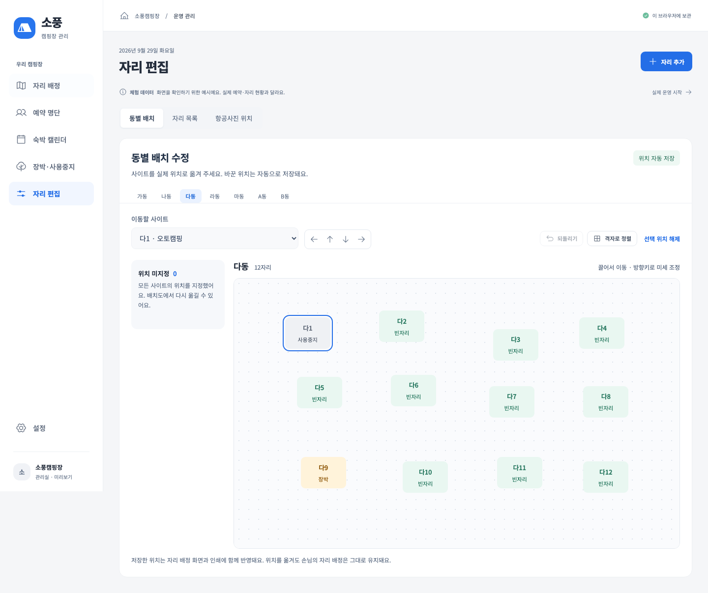

# 동별 배치 편집 · 0.1.4

2026-09-29 사용자 요청: “각 동별로 캠핑 사이트를 실제 위치대로 배치를 수정 할 수 있게 하고싶어”. 각 동의 사이트 위치를 직접 수정하고, 자리 배정 화면과 인쇄에서 같은 배치를 사용하도록 구현했다.

## 사용 방법

1. **자리 편집 → 동별 배치**를 열고 수정할 동을 선택한다. 자리 배정 화면의 동 제목 옆 **배치 수정**으로도 바로 열 수 있다.
2. 아직 등록하지 않은 사이트는 위의 **자리 추가**로 이름·동·숙박 유형을 먼저 등록한다.
3. **위치 미지정**에 있는 사이트를 배치도로 끌어 놓는다. 사이트를 선택한 뒤 배치도의 원하는 위치를 눌러도 된다.
4. 배치한 사이트를 다시 끌어 옮긴다. 방향 버튼 또는 키보드 방향키는 조금씩, Shift+방향키는 더 크게 이동한다.
5. 위치는 이동을 마칠 때 자동 저장된다. **되돌리기**는 편집 화면에 머무르는 동안 동별 최근 30개 변경을 되돌린다. 프로그램을 다시 열어도 저장된 위치는 유지되지만 되돌리기 목록은 초기화된다.

**격자로 정렬**은 선택한 동의 사이트를 일정한 간격으로 배치하므로 처음 배치를 시작할 때 유용하다. **선택 위치 해제**는 위치 지정만 해제한다. 사이트나 예약을 삭제하지 않는다. 마우스 이동이 어렵다면 사이트를 선택하고 **가운데 놓기**, 방향 버튼을 사용한다.

위 화면의 사이트 수·위치·장박은 기능을 보여 주기 위한 체험 데이터이며 실제 캠핑장 현황이 아니다.

## 저장과 기존 데이터

- 동별 위치를 바꿔도 손님의 예약·배정·장박·사용중지 기록은 유지된다. 빈자리·배정·장박·사용중지는 기존 색상으로 구분한다.
- 저장한 위치는 자리 배정 화면, 인쇄 배치도, 백업에 포함된다. 위치 미지정 사이트는 별도 목록에 계속 표시된다. 동 전체의 위치가 미지정이면 기존 격자 화면을 사용한다.
- 저장이 실패하면 이전 위치를 유지하고 오류를 표시한다. 다시 시도할 수 있다.
- 자리 목록에서 사이트의 소속 동을 바꾸면 새 동에서 위치를 다시 지정한다. 예약과 사이트 ID의 연결은 유지한다.
- **항공사진 위치** 탭의 전체 사진 위 좌표는 동별 배치와 별개로 유지된다. 기존 항공사진 위치를 덮어쓰지 않는다.
- 예전 백업처럼 동별 위치가 없는 데이터도 그대로 읽는다. 실제 위치는 운영자가 확인한 자료를 바탕으로 지정하며, A동의 전체 개수 등 미확인 정보는 추정 등록하지 않았다.

## 검증 결과

- TypeScript 검사, 제품 빌드, 코드 형식 검사 통과.
- 단위·저장 테스트 **39개**, 브라우저 기능 테스트 **26개** 통과.
- 새 검증: 위치 저장·복원, 예약·항공사진 좌표 보존, 잘못된 좌표·다른 동·삭제된 자리 거절, 소속 동 변경, 클릭·드래그·방향키 이동, 동별 되돌리기, 격자 정렬, 위치 해제, 저장 실패·재시도, 화면 경계 처리.
- 1440px·960px·390px 화면에서 편집 동작과 페이지 가로 넘침을 확인했다. 배치도 내부는 필요하면 가로로 스크롤한다. 배정 화면과 인쇄 미리보기에도 저장한 위치가 반영됨을 확인했다.
- Mac의 **Electron 22.3.27 / Chromium 108**에서 위치 드래그, 실제 JSON 파일 저장, 잠금·재실행 후 위치 유지, 새 설치에 백업 복원을 확인했다. 기존 PIN·비밀번호, 가져오기, 백업·손상 복구, 오전 9시 입실도 통과했다.
- Windows x64·ia32 통합 설치 파일은 `release/Sopung-Camp-Setup-0.1.4.exe`다. **Windows 실제 설치·실행·업데이트와 프린터 출력은 아직 미검증**이다.
- 두 Windows 실행 파일의 PE 아키텍처와 패키지 버전 0.1.4를 확인했다. 각 패키지의 제품 번들·Electron 소스 132개가 최종 빌드와 일치한다. 설치 파일 SHA-256은 [검증값 파일](../release/Sopung-Camp-Setup-0.1.4.exe.sha256)에 보관했다.

구현: `src/AreaLayout.tsx`, `src/App.tsx`, `src/styles.css`, `src/domain.ts`.
검증: `tests/layout.test.ts`, `tests/ui/layout.spec.ts`, `tests/desktop.cjs`.
