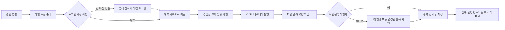

# 캠핏 로그인 후 자동 내려받기 설계

2026-11-06. 사용자 Q72 요청에 대한 설계이며 **0.1.15에 자동 연결 기능을 구현했다는 뜻은 아니다.** 이번 설치 파일 변경은 저장된 자리배치다. 실제 캠핏 로그인·예약 파일 수신·반영 검증은 남아 있다.

## 제안

별도 ‘로그인’과 ‘동기화’ 조작을 **‘캠핏 연결’ 한 흐름으로 합친다.** 앱이 파일 수신을 먼저 준비하고, 사용자가 공식 캠핏 창에 로그인하면 확인된 예약 화면으로 이동하여 XLSX 내보내기를 실행한다. 받은 파일을 검사해 기존 예약 관리 규칙으로 저장한다. 연결 후에는 로그인 세션이 유효하면 다시 로그인하지 않고 같은 흐름을 실행한다.

현재 구조에서 가장 현실적인 방법은 **공식 캠지기센터의 내보내기 기능을 자동 조작하는 방식**이다. 제공 여부와 이용 자격이 확인된 공식 예약 조회 API가 있으면 API 방식을 우선한다. API가 없다고 단정하거나 확인되지 않은 주소를 만들어 호출하지 않는다.

## 이번에 확인한 근거

- 사용자는 이전 Windows에서 로그인과 엑셀 내려받기까지 했다고 답했으며, 이번에 확장자를 **`.xlsx`**라고 확인했다(Q73). 확장자는 현재 파서의 지원 범위다. 실제 파일 내용·열·날짜·상품·상태는 아직 확인하지 않았다.
- 현재 `설정 → 캠핏 로그인`은 `openCampfit()`만 호출한다. `CamfitSync.receive()`는 진행 중인 동기화 작업이 없으면 파일을 받아 앱으로 가져오지 않는다. 따라서 로그인 창만 열고 내려받는 흐름이 앱 반영으로 이어지지 않는 코드 구조를 확인했다. 이것이 당시 ‘완료할 수 없음’ 오류의 정확한 원인이었는지는 미확인이다.
- `CamfitSyncForm`을 열어야 수신을 시작한다. 첫 연결에는 사람이 내보내기를 누르고 열·상품·상태를 확인해야 한다. 연결 후에는 저장한 화면 경로와 버튼 이름이 맞아야 자동으로 클릭한다.
- 로그인이 만료되어 대시보드로 돌아가면 현재 코드는 저장한 예약 경로로 다시 안내하지 않는다. 경로가 다르면 대기 후 오류가 난다. 주소의 쿼리도 전부 제거하므로 실제 화면이 업체·기간 쿼리를 요구한다면 현재 프로필만으로 재현할 수 없다. 실제 화면을 보기 전 이 조건을 확정하지 않는다.
- [캠핏 공식 사업자 안내](https://biz.camfit.co.kr/)는 예약관리·일일 예약표·네이버 연동을 소개한다. 이번 공개 검색에서는 자체 제작 앱을 위한 예약 조회 API 문서와 신청 조건을 확인하지 못했다. 네이버 연동 안내만으로 외부 앱 API를 사용할 수 있다고 보지 않는다.
- [공식 캠지기센터](https://admin.camfit.co.kr/)의 공개 조회에서는 읽을 수 있는 예약 화면이 없었고 직접 HTTP 조회도 403이었다. 로그인 뒤 화면·메뉴·요청 주소는 조사하지 못했으며 접근 제한을 우회하지 않았다.

## 사용 흐름

첫 연결부터 엑셀 버튼을 직접 누르지 않아도 되게 하는 것이 목표다. 이를 위해 실제 예약 화면의 메뉴·내보내기 버튼을 한 번 확인해 전용 어댑터에 반영해야 한다. 계정마다 다른 상품을 객실 유형에 연결하는 판단까지 추측하지 않는다. 확인된 XLSX 형식이면 열을 자동 연결하고, 모호한 열·새 상품·새 상태만 첫 연결 화면에서 확인한다.

## 구현 구분

| 부분 | 현재 재사용할 기능 | 필요한 변경 |
|---|---|---|
| 연결 시작 | 격리된 캠핏 창·영속 세션 | 로그인 창을 열기 전 수신 준비, 하나의 연결 작업 관리 |
| 로그인 완료 | 공식 도메인 이동 제한 | 로그인 화면 이탈만으로 성공 처리하지 않고 인증된 예약 화면·업체 선택 확인 |
| 예약 화면 이동 | 프로필의 경로 | 로그인 후 예약 경로 복귀, 실제 화면 기준 메뉴 탐색 |
| 업체·조회 범위 | 현재 화면 내보내기 | 한 업체이면 자동 선택, 여러 업체이면 최초 한 번 선택. 실제 필터를 읽고 범위를 앱에 표시 |
| 내보내기 | 버튼 이름 검사·DownloadItem 수신 | 실제 XLSX 버튼·추가 선택창 처리, SPA 전환 후 재탐색, 한 작업당 한 번만 클릭 |
| 파일 해석 | XLSX 읽기·열 연결·중복 검사 | 실제 캠핏 샘플 기준 형식 식별, 첫 연결 자동 연결 보완 |
| 저장 | 취소·날짜 변경 보류·현장 기록 보존 | 저장 완료 후에만 연결 성공·완료 시각 표시 |
| 재연결 | 세션 재사용 | 세션 만료 시 로그인 안내 후 같은 작업을 이어서 실행 |

조회 기간은 임의의 30일·90일로 고정하지 않는다. 전체 예약 내보내기가 가능하면 그 기능을 검토하고, 기간 제한이 있으면 사용자가 첫 연결에서 선택한 범위를 저장·표시한다. 기간 분할이 필요하면 실제 제공 범위와 식별자를 확인한 뒤 중복 없이 합친다. 취소 상태 필터와 이용 중 예약이 누락되지 않는지도 검사한다.

## 운영 기록을 지키는 조건

- ‘로그인 완료’, ‘파일 수신’, ‘앱 저장 완료’를 별도 상태로 표시한다. 파일만 내려받고 성공으로 표시하지 않는다.
- 취소·일정 변경은 기존 Q23·Q29대로 확인 목록에 보류한다. 현장 연장·메모·차량·배정·장박은 기존 규칙을 유지한다. 목록에서 빠진 예약을 취소로 해석하지 않는다.
- 인증 도중 앱 잠금·창 닫기·연결 중단이 발생하면 작업을 취소하고 기존 예약을 유지한다. 중복 클릭·로그인 리디렉션마다 중복 작업을 시작하지 않는다.
- 비밀번호·쿠키·인증 토큰을 앱 예약 JSON이나 진단 로그에 복사하지 않는다. 업체·기간 쿼리가 필요하면 실제 확인한 항목만 따로 저장한다.
- 추가 인증·다운로드 사유·비밀번호 입력이 필요한 경우에는 해당 공식 화면에서 사용자 입력을 기다린다. CAPTCHA나 접근 제한을 우회하지 않는다.
- Windows 8·8.1·10·11 목표와 Electron 22 고정을 유지한다. 실제 캠핏이 구형 Chromium에서 동작하는지는 Windows에서 별도 검증한다. 최신 실행기 도입으로 지원 범위를 임의로 바꾸지 않는다.
- 로그인 직후 수신이 이번 목표다. 주기 자동 수신과 앱이 꺼진 동안의 수신은 이번 요청으로 확정하지 않는다.

## 실제 연결을 완성하기 위해 필요한 자료

1. 캠핏에서 이미 내려받은 `.xlsx`의 시트·제목 행·예약번호·입퇴실일·상품·객실·상태 구조. 검토용 사본은 손님 이름·전화번호·메모를 가려도 된다. 같은 예약의 여러 자리 식별 방식은 유지해야 한다.
2. Windows에서 사용자가 직접 로그인한 상태의 예약 목록 메뉴와 XLSX 내보내기 조작. 이후 실제 화면에 맞춰 어댑터를 구현한다. 지금 로그인이나 비밀번호 전달을 요구하지 않는다.
3. 첫 로그인, 저장된 세션, 세션 만료, 새 상품·열 변경, 빈 결과, 취소·날짜 변경, 중복 수신, 다운로드·저장 실패를 실제 파일과 대상 Windows에서 확인한다.

이 자료가 확인되기 전에는 모의 화면 테스트 통과를 실제 캠핏 자동 연결 완성으로 보고하지 않는다. 관련 코드: `electron/camfit.cjs`, `electron/camfit-sync.cjs`, `src/CamfitSyncForm.tsx`, `src/camfitSync.ts`.
