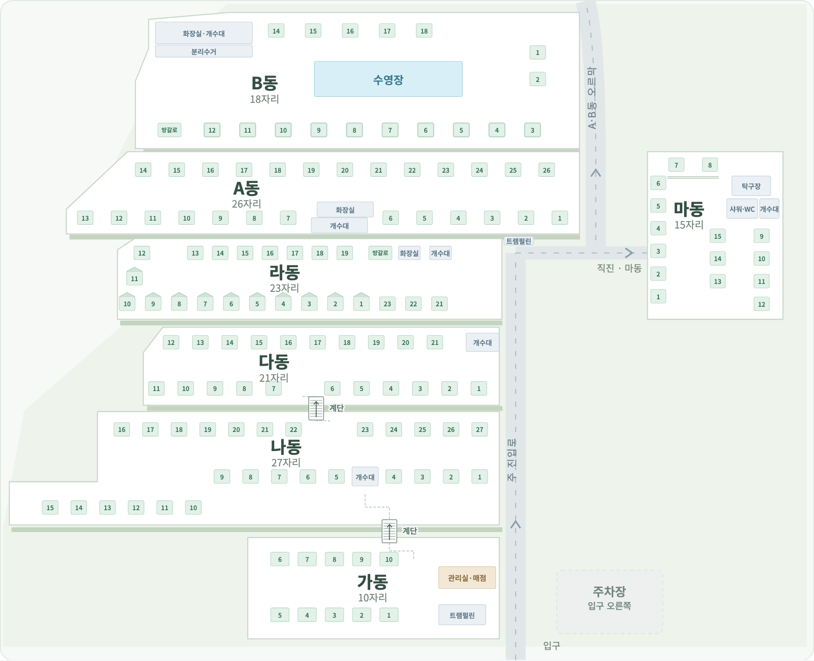

# 마동·갈림길·계단 위치 수정

2026-10-06 · 0.1.7 기록. 최신 추가 수정은 [0.1.8 사용성 기록](usability-update-2026-10-06.md)을 따른다. 아래 전체 지도 이미지는 최신 0.1.8 표시다.

사용자 현장 확인(Q55–Q57)에 따라 전체 배치를 정정했다. 2026-10-05 사진 해석보다 이번 지시가 우선한다.

- 마동은 도로 건너 A동·라동과 나란히 놓인다. 위쪽 끝은 A동, 아래쪽 끝은 라동에 맞추고 마동의 사이트·시설을 함께 위로 옮겼다.
- 라동에서 오른쪽으로 이동하는 길의 중간에서 왼쪽으로 꺾으면 A·B동으로 올라간다. 직진은 마동 방향이다. 상부 오르막을 하부 진입로보다 오른쪽으로 이동하고 갈림길·방향 화살표·목적지 이름을 표시했다. [사용자 제공 갈림길 도면](reference/user-road-junction-2026-10-06.png).
- 다6·7 사이와 나22·23 사이를 연결하는 계단, 나4·5 사이와 가10 오른쪽을 연결하는 계단을 표시했다. 전체 지도에는 연결선·계단 표시 두 개, 동 상세·배치 편집·인쇄에는 각 연결 끝 네 개를 표시한다. [사용자 계단 위치 화면](reference/user-stair-gap-2026-10-06.png).

[다동 상세](screenshots/site-plan-da-stairs.png), [나동 상세](screenshots/site-plan-na-stairs.png), [가동 상세](screenshots/site-plan-ga-stairs.png).

계단은 `src/sitePlan.ts`의 표시용 연결 정보이며 점유 가능한 사이트나 운영 시설 객체를 만들지 않는다. 자리·시설 데이터는 140개·14개를 유지한다. 현재 저장된 자리 위치를 따라 계단을 표시하며 필요한 자리가 없거나 보관 처리되어 있으면 해당 연결을 표시하지 않는다. 개수대와 자리 표시를 가리지 않도록 연결 끝을 띄웠다. 예약·배정·장박·PIN과 운영 JSON을 변경하는 마이그레이션은 필요 없다.

## 검증

- TypeScript·제품 빌드·코드 형식 검사 통과.
- 관련 UI 테스트 5개 통과: 마동과 A·라동의 높이, 도로 갈림, 140자리·14시설·2계단 연결, 상세·인쇄의 계단 끝 4개, 기존 상태 색·시설 이동·손님 배정·날짜 유지·좁은 창 동작 확인.
- 다·나·가동 상세 화면의 계단 표시와 자리·시설 표시가 겹치지 않음을 확인했다.
- 960px·390px에서 페이지 가로 넘침 없이 두 계단과 마동 상세 진입·복귀 확인.
- Mac 앱을 최종 0.1.7 빌드로 재실행했고 운영 JSON의 바이트가 전후 동일함을 확인했다.
- Windows x64·ia32 실행 파일의 PE 아키텍처·앱 버전과 각 패키지의 제품 파일 133개 일치를 확인했다.
- 0.1.6에서 전체 UI 31개·운영 테스트 44개와 Mac Electron 22 기능 검증을 통과했다. 이번에는 변경에 관련된 UI 5개를 재검증했으며 기존 전체 테스트를 다시 실행했다고 표현하지 않는다.

Windows 8·8.1·10·11 지원 목표와 Electron 22 고정을 유지한다. Windows 실기기 설치·실행 검증은 남아 있다.

설치 파일: [Sopung-Camp-Setup-0.1.7.exe](../release/Sopung-Camp-Setup-0.1.7.exe), 144,476,014바이트. [SHA-256 파일](../release/Sopung-Camp-Setup-0.1.7.exe.sha256): `e227d9d962c65ededab9b71b9f0b75b7e38fe16a573640c177045a4c6efe873b`.

캠핏은 로그인 창과 CSV/XLSX 수동 가져오기를 지원한다. 로그인만으로 예약이 자동 수집되는 기능은 구현하지 않았다. 사용자는 Windows 설치 후 직접 로그인하기로 했으며 지금 로그인이나 비밀번호 전달을 다시 요청하지 않는다.
