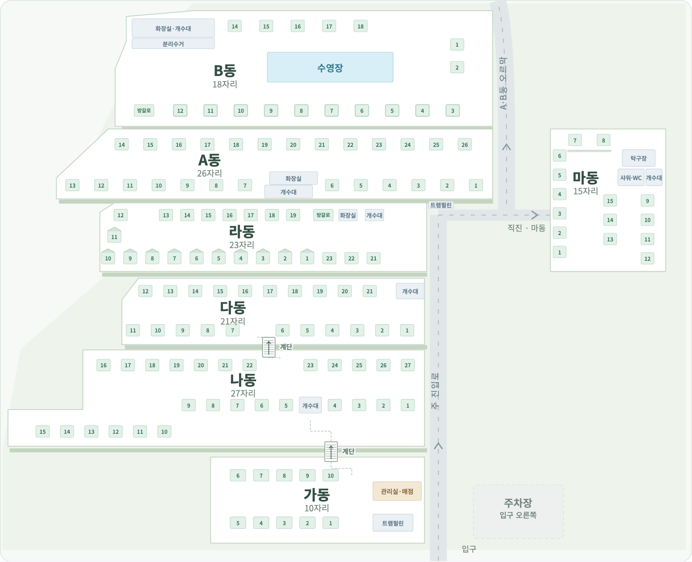

# 전체 배치의 위치·모양 수정

작성 2026-10-05 · 0.1.6. 마동 위치 갱신 2026-10-06 · 0.1.7.

2026-10-06 사용자가 마동은 A동·라동과 나란히 놓인다고 정정했다(Q55). 최신 화면은 마동 윗끝을 A동, 아랫끝을 라동에 맞추고 진입로도 함께 위로 옮긴다. 사이트·시설은 마동 안의 배치를 유지하며 전체 지도 표시 위치만 갱신한다. 아래 0.1.6의 초기 사진 해석보다 사용자 정정이 우선한다. 이어서 확인한 A·B동 오르막 갈림과 두 계단은 [2026-10-06 정정 기록](layout-corrections-2026-10-06.md)을 따른다.

기존 전체 도식은 동을 같은 폭의 상자로 나열해 실제 위치·크기·꺾임을 충분히 표현하지 못했다. 사용자가 제공한 두 도면을 주 진입로에 맞춰 연결하고 항공사진·현장 안내판·공식 B동 사진을 대조해 전체 평면도를 다시 그렸다. 동 클릭 → 동 상세 → 자리 선택 흐름을 유지한다.

## 위치를 맞춘 기준

| 구역 | 반영한 모양·위치 |
|---|---|
| B | 가장 위. 왼쪽 편의시설, 가운데 수영장, 아래 카라반 줄, 오른쪽 B1·2, 위쪽 B14–18 |
| A | B보다 왼쪽으로 길게 뻗은 두 줄. 윗줄 시작은 아랫줄보다 안쪽이며 오른쪽 끝은 도로 쪽으로 맞춤 |
| 라 | A 아래. 글램핑1–10이 아래 줄, 11·12가 왼쪽. 방갈로 A·화장실·개수대는 위쪽 오른편 |
| 마 | A동·라동 오른쪽 도로 건너편. 위쪽 끝은 A동, 아래쪽 끝은 라동에 맞추는 세로 구역. 시설은 오른쪽 위. 2026-10-06 사용자 정정 반영 |
| 다 | 라 아래의 두 줄이며 왼쪽 모서리가 꺾임. 개수대는 위쪽 오른편 |
| 나 | 다 아래. 가장 길게 왼쪽으로 뻗고 10–15번 줄이 왼쪽 아래로 꺾임 |
| 가 | 가장 아래의 짧은 두 줄. 오른쪽에 관리실·매점과 트램펄린 |
| 진입로 | 각 동의 오른쪽을 따라 위로 연결. 마동 진입은 도로 건너편, 입구는 아래쪽, 주차장은 입구 오른쪽 |

전체 지도에도 저장된 140자리와 14시설을 표시한다. 사이트 상태는 선택한 날짜의 빈자리·배정·장박·사용중지 색과 툴팁으로 확인할 수 있다. 글램핑은 지붕 모양, 카라반은 이중 테두리로 구별한다. 동별 클릭과 Enter·Space 키 선택을 지원한다.

자리·시설 위치는 현재 운영 데이터에서 읽으며 편집한 위치를 전체 지도에도 반영한다. 전체 화면의 상대 위치 투영만 변경하므로 자리 ID·예약·배정·장박·항공사진 좌표를 갱신하지 않는다. 실제 거리·방위는 측량 자료가 없어 사진·도면의 상대 배치를 기준으로 한다.

## 대조한 자료

- 사용자 제공 [하단 도면](reference/user-plan-2026-10-05-lower.png), [상단 도면](reference/user-plan-2026-10-05-upper.png): 번호·줄 방향·시설과 동 사이 연결의 기준.
- [사용자 제공 전체 항공사진](reference/user-aerial.jpg), [현장 안내판](reference/site-sign.jpg): 동별 상대 폭, 짧은 가동, 도로·입구·주차장 위치 대조.
- [공식 카라반 배치 페이지](https://xn--9l4bn7g0ravfq75abijilb.kr/36)의 [B동 배치 사진](https://cdn.imweb.me/thumbnail/20231128/9a126984b5e21.jpg): 왼쪽 편의시설·중앙 수영장·아래 카라반 줄 확인. [로컬 보존본](reference/official-layout-2026-10-05.jpg).
- 공식 홈페이지의 [B동 항공사진](https://cdn.imweb.me/thumbnail/20231117/6656e370a0e28.jpg): B동 외곽과 오른쪽 진입로 대조. [로컬 보존본](reference/official-b-aerial-2026-10-05.jpg).

공식 사진은 2023년 업로드 경로의 자료이며 2026-10-05에 열어 확인했다. 해당 사진의 텐트·빈자리 개수로 현재 재고를 변경하지 않는다. 번호 목록·유형은 사용자가 제공한 도면과 최신 지시를 따른다. 사진의 장박도 등록하지 않는다.

## 검증

- TypeScript·제품 빌드와 코드 형식 검사 통과.
- 운영 규칙·저장 등 기존 자동 테스트 44개 통과.
- UI 테스트 31개 통과. 가동과 나동의 폭 차이·왼쪽 확장, 라·마의 도로 양쪽 위치, 마동 세로 길이를 실제 화면 크기로 확인.
- 마지막 줄 간격·시설 폭 조정 후 관련 UI 테스트 5개 재검증 통과. 기본 도면의 사이트·시설 표시 사이 겹침 없음 확인.
- 140개 사이트·14시설, 빈자리·배정·장박·사용중지의 서로 다른 색, 시설 위치 변경의 전체 지도 반영, Enter·Space 동 선택과 기존 손님 배정·날짜 유지 확인.
- 960px·390px에서도 전체 지도 가로 넘침 없이 마동 상세 진입·복귀 확인.
- Mac Electron 22 / Chromium 108에서 전체 지도의 동 선택과 기존 PIN·저장·백업·복원·시설 편집 등 통과.
- 최종 빌드로 Mac 앱을 재실행했으며 기존 운영 JSON의 바이트가 그대로 보존됨을 확인했다.
- Windows x64·ia32 통합 설치 파일을 생성하고 양쪽 실행 파일의 PE 아키텍처·앱 버전 0.1.6·각 패키지의 제품 파일 133개 일치를 확인했다. 실제 Windows 8·8.1·10·11 설치·실행 검증은 남아 있다.

설치 파일: [Sopung-Camp-Setup-0.1.6.exe](../release/Sopung-Camp-Setup-0.1.6.exe), 144,475,856바이트. [SHA-256 파일](../release/Sopung-Camp-Setup-0.1.6.exe.sha256): `f7c36824911833ac5cd387d806fd454b3489f3e5b8d1d3e4a19a77761b7bf026`.

구현: `src/CampOverview.tsx`, `src/App.tsx`, `src/styles.css`. 운영 JSON을 수정하는 마이그레이션은 필요 없다. 캠핏 로그인·자동 가져오기의 구현 범위도 이 변경으로 확장하지 않았다.
