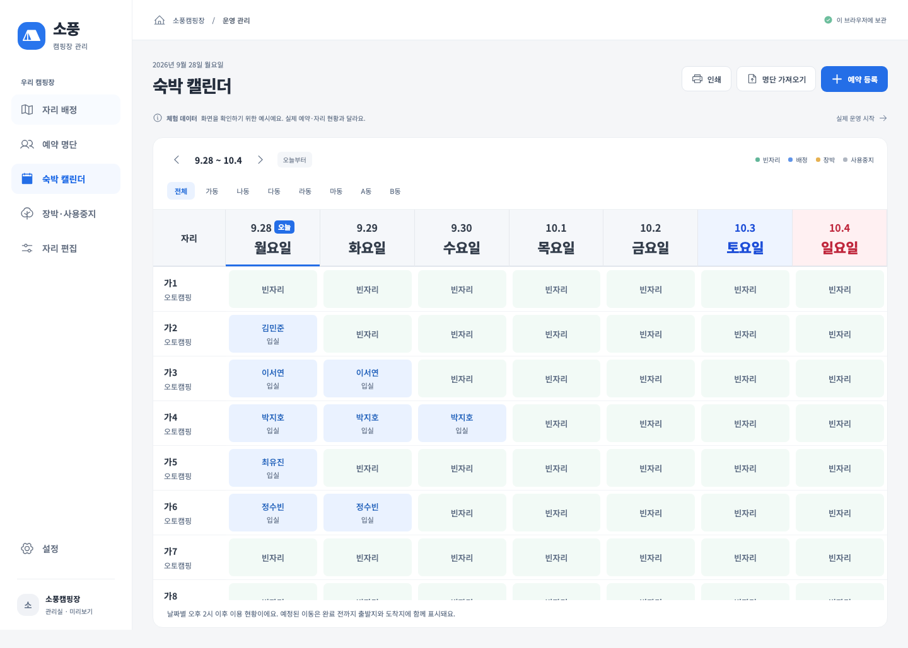

# 전체 재검토와 수정 기록

2026-09-28 · 수정 버전 0.1.1

사용자가 캘린더의 요일 가독성을 높이고 전체 프로그램의 개선점을 재검토해 달라고 요청했다. 기존 React·Electron 구조와 자리 상태 색상을 유지하면서 사용 중 혼동과 데이터 처리 오류를 수정했다.

## 화면 개선

- 캘린더 요일을 기존 10px에서 22px·굵기 800으로 변경했다. 토요일은 파랑, 일요일은 빨강, 오늘은 명시적인 ‘오늘’ 표시와 밑줄로 구별한다.
- 날짜·요일 헤더와 자리 이름 열의 스크롤 고정을 유지하고, 관리실 앱의 최소 창 크기인 960×680에서도 일주일 전체 열이 보이도록 조정했다. 좁은 브라우저 미리보기에서는 표 안에서 가로 스크롤한다.
- 예약·장박 날짜 입력 아래에 한국어 연도·날짜·요일을 표시한다. 예약 상세의 입·퇴실일에도 연도와 요일을 함께 표시한다.
- 캘린더의 예약자 이름·상태, 명단의 이름·연락처, 입력란 글자를 키웠다.
- 일주일 구간이 오늘부터 시작하는 동작에 맞춰 ‘이번 주’ 버튼을 ‘오늘부터’로 정정했다.

## 확인한 문제와 수정

| 구분 | 기존 문제 | 수정 후 |
|---|---|---|
| 날짜 입력 | 예약 입실일이나 장박 시작일을 지우면 유효하지 않은 날짜 계산으로 화면이 사라짐 | 빈 입력을 허용하고 필수 입력 검증으로 안내. 유효한 날짜일 때만 다음 날짜 계산 |
| 캘린더 범위 | 목요일 칸을 누르면 캘린더 전체 시작일도 목요일로 바뀜 | 열어 본 날짜를 상세 창에 따로 보관하고 원래 주간 범위 유지 |
| 캘린더 상세 | 오전 퇴실·오후 입실이 같은 자리에 있으면 캘린더 표시와 클릭 후 손님이 달라질 수 있음 | 칸 표시와 상세 창 모두 해당 날짜 오후 2시 이후 기준 사용 |
| 현장 입실 | 과거·미래 날짜의 빈자리 화면에서도 현장 입실 버튼을 누를 수 있음 | 오늘 날짜·현재 입실 가능 기간을 먼저 안내하고 잘못된 실행 방지 |
| 최신 예약 변경 | 최신 파일에서 취소가 철회돼도 이전 취소 확인이 남음 | 철회된 보류 알림 정리. 이미 확정한 취소·노쇼는 되살리지 않음 |
| 날짜 변경 철회 | 원본이 기존 날짜로 돌아오면 불필요한 변경 확인이 남음 | 최신 명단과 현재 기록이 같으면 보류 알림 해제. 현장 연장과 기존 배정 보존 |
| 종료된 예약 | 직접 노쇼·퇴실 처리 뒤 실행할 수 없는 변경 안내가 남음 | 종료 시 해당 예약의 보류 알림도 정리 |
| 파일 가져오기 | 새 파일 읽기 실패 후 이전 파일 미리보기와 가져오기 버튼이 남음 | 새 파일 선택 즉시 이전 미리보기 제거. 실패한 파일 대신 이전 명단을 가져오지 못하게 함 |
| 검색 | 명단 화면에 도착 전 필터가 기본 적용돼 입실·과거 손님 검색을 놓치기 쉬움 | 명단은 모든 상태로 시작. 자리 배정 화면의 도착 전 필터와 별도 관리 |
| 검색 안내 | 검색 결과가 없으면 빈 표만 표시. 전화번호에 공백을 넣으면 검색 실패 가능 | 결과 없음 안내 추가. 공백·하이픈·괄호가 있는 연락처 검색 지원 |
| 초기 명단 확인 | 자리를 아직 등록하지 않았으면 가져온 예약 명단도 가려짐 | 자리 등록 전에도 예약 명단 조회 가능 |
| 연락처 수정 | 정보 수정 화면에서 이름·연락처를 바로잡을 수 없음 | 이름·연락처 수정 및 변경 기록 추가. 자동 가져오기에서 원본 차이도 구체적으로 안내 |
| 백업 복원 | 새 PC의 첫 실행처럼 원본 파일이 없으면 복원 전 백업 단계에서 실패 | 보관할 기존 파일이 있을 때만 먼저 백업하고 새 설치에서도 복원 가능 |
| 복원 후 설정 | 복원된 레이트 시각·요금과 설정 입력란 값이 달라질 수 있음 | 복원된 실제 값으로 입력란 동기화 |
| 설정 파일 손상 | 백업 설정 파일이 손상되면 창 없이 시작에 실패할 수 있음 | 잘못된 설정을 검사하고 파일 위치와 원인을 안내. 기존 예약·설정 파일 보존 |
| 작은 화면 인쇄 | 작은 PC 창에서 인쇄 버튼 자체가 숨겨짐 | 아이콘 버튼으로 유지하고 이름·도움말 제공 |

## 검증

- TypeScript 검사와 제품 번들 빌드 통과.
- 운영 규칙·명단 가져오기·파일 보관 관련 자동 테스트 23개 통과. 취소·날짜 변경 철회와 종료 후 알림 정리를 포함한다.
- 브라우저 기능 테스트 12개 통과. 실제 오류를 재현한 날짜 지우기, 캘린더의 동일 자리 오전·오후 손님, 파일 읽기 실패, 이름·연락처 수정 등을 검증했다.
- 1440×1000, 960×680, 390×844에서 여섯 주요 화면을 확인했다. 페이지 전체의 가로 넘침이 없고, 날짜 헤더는 표를 스크롤해도 유지된다.
- 컴퓨터 시간대를 미국 로스앤젤레스로 설정한 브라우저에서도 한국 날짜의 요일이 유지되는 것을 확인했다. 월·연도·윤년 경계도 별도로 검증했다.
- Mac의 Electron 22 / Chromium 108에서 PIN·XLSX·저장·백업·잠금·재실행 검증과 새 설치 상태에서의 백업 복원을 통과했다. 이 검증은 별도 임시 데이터 폴더를 사용했다.
- Windows x64·ia32 통합 [0.1.1 설치 파일](../release/Sopung-Camp-Setup-0.1.1.exe)을 다시 제작했다(137.8MiB). 두 아키텍처 실행 파일의 PE 형식, 패키지 버전과 내부 UI·저장 코드가 최종 빌드와 일치하는 것을 확인했다. [SHA-256](../release/Sopung-Camp-Setup-0.1.1.exe.sha256)을 함께 보관한다. 실제 Windows에서 설치·업데이트·인쇄까지 확인한 것은 아니다.
- `npm audit --omit=dev` 기준 배포 의존성 취약점 0건. 개발 도구와 Electron 실행기의 보안 지원 종료까지 해결했다는 의미는 아니며 아래 호환성 검토를 따른다.

## 남은 확인 범위

실제 관리실 Windows PC에서의 설치·업데이트 검증, 캠핏·네이버 실제 내보내기 파일 검증, 현장 자리 목록·장박과 레이트 시간·금액 확인은 남아 있다. 자동 예약 불러오기는 공식 연동 권한·규격이 아직 확인되지 않아 이번 수정에 포함하지 않았다. [자동 연동 조사](site-research.md#예약-자동-불러오기-추가-검토)를 참고한다.

Windows 8 지원을 위한 Electron 22의 보안 지원 종료와 코드 서명·잠금 분실 복구 정책은 기존 [호환성 검토](windows-compatibility.md)의 미결정 사항으로 유지한다.
