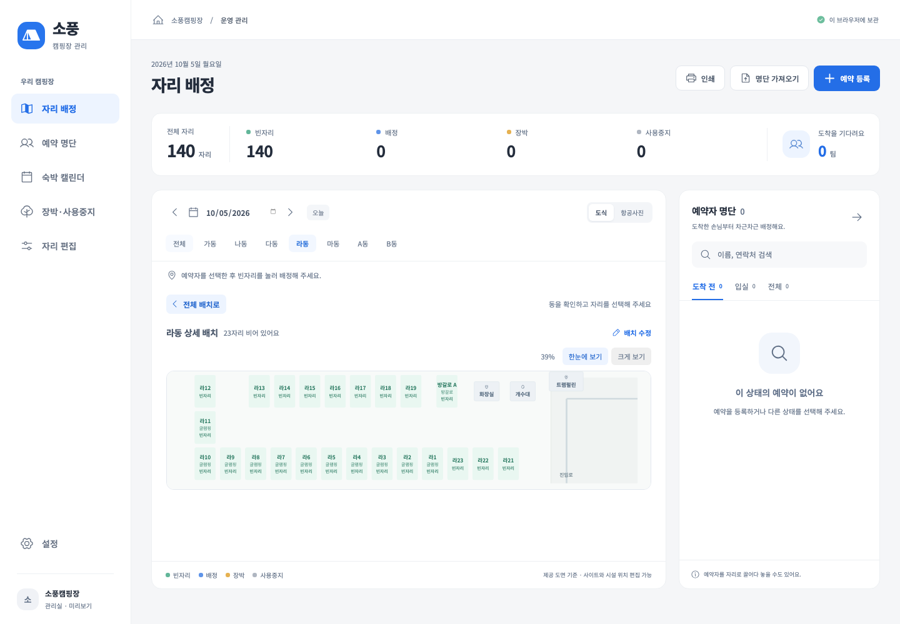
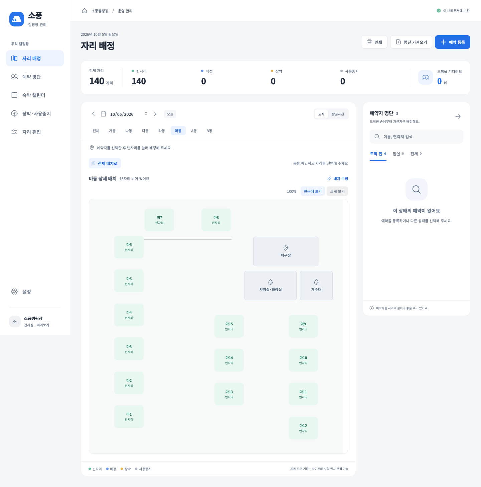

# 라동 트램펄린과 마7·마8 단차

2026-10-06 · 0.1.11 (0.1.9·0.1.10 기록 포함)

사용자는 트램펄린이 라동 내부가 아니라 오른쪽으로 꺾이는 길목이라고 정정한 뒤(Q65), 길의 아래가 아닌 **위쪽**이라고 확정했다(Q68). 이후 수직 진입로가 가로길로 꺾이는 **모서리 바로 위쪽**에 중심을 맞추도록 정정했다(Q69). 가동 트램펄린과 별도로 등록해 시설은 15개이며 자리는 140개다. 전체 지도와 라동 상세·시설 편집·인쇄에 표시한다. 트램펄린은 라동 경계 밖 꺾이는 가로길 위쪽에 표시하고 A·B동 오르막 / 마동 직진 갈림 관계를 유지한다.

마7·마8은 조금 높은 곳에 있고 작은 계단으로 올라간다고 확인했다(Q66). 최종 요청대로 두 자리 아래에 얇은 단차 선만 그린다. ‘계단 위’ 문구·계단 그림·큰 높임 영역은 표시하지 않는다. 자리 선택은 그대로 가능하다. 상세·편집·인쇄에도 표시하며 저장된 자리 위치를 따라간다. 높이, 실제 단 수나 추가 이용 제한은 추정하지 않는다.

모서리 정렬은 [최신 사용자 화면](reference/user-trampoline-at-turn-2026-10-06.png)의 지시를 우선한다. 트램펄린의 위아래 방향은 [최신 사용자 정정 화면](reference/user-trampoline-above-road-2026-10-06.png)을 우선한다. 라동 경계 밖 위치는 [라동 밖 길목 정정](reference/user-trampoline-outside-ra-2026-10-06.png)과 [길목 확대](reference/user-trampoline-road-corner-2026-10-06.png)를 우선한다. 최초 설명 자료는 [사용자 트램펄린 설명 화면](reference/user-ra-trampoline-2026-10-06.png), [사용자 마동 설명 화면](reference/user-ma-raised-sites-2026-10-06.png)와 인터뷰 답변이다.

이전 도면 ID `sopung-user-plan-2026-10-05`는 첫 불러오기에서 `sopung-user-plan-2026-10-06`으로 갱신한다. 라동 화면 폭을 1600→2000으로 늘리고 기존 라동 가로 좌표·시설 폭을 `(1600−108)/(2000−108)`로 변환한다. 실제 화면의 기존 간격과 운영자가 편집한 위치를 유지하며 오른쪽에 시설을 추가할 공간만 확보한다. 예약·배정·장박·사용중지·변경 확인·설정·항공사진 좌표와 다른 동 위치는 보존한다. 사용자가 별도로 등록한 라동 트램펄린이 있으면 추가로 중복 등록하지 않는다. 초기에 트램펄린을 내부 시설로 표시했던 저장본은 `location: approach`를 한 번 추가하고 기본 위치였던 트램펄린만 길목으로 옮긴다. 이 정정에서는 자리·다른 시설 좌표를 다시 변환하지 않는다. 시설 관리상 라동에 연결되지만 도식에서는 진입로 구역이다. 두 번째 불러오기에는 다시 변환하거나 추가하지 않는다. 사용자 편집을 초기 도면으로 되돌리는 전체 재적용을 사용하지 않는다.

0.1.9에서는 운영 테스트 51개·UI 34개·TypeScript/제품 빌드/형식 검사를 통과했다. 새 테스트는 이전 배치의 편집 위치와 예약·배정·장박 보존, 중복 갱신 방지, 전체 지도에서 라동 경계 밖 갈림길의 트램펄린 위치, 마7 선택과 상세·편집·인쇄 표시를 확인한다. Mac Electron 22에서는 실제 저장 파일의 이전 도면 갱신과 재실행 보존, 기존 동기화·잠금·종료 기능을 검증했다. 실제 캠핏 인증·내보내기와 Windows 설치·실행은 미검증이다.

Mac 운영 데이터 갱신 전 원본은 `/Users/bj/Library/Application Support/Sopung Camp/before-layout-update-0.1.9-2026-10-06T03-41-06-479Z.json`에 보관했다. 갱신 후 자리 140개·시설 15개, 예약·배정·장박 각각 0건, 다른 동·운영 기록·기존 라동 간격·PIN 설정의 보존을 확인했다.

마동 클릭 후 화면이 떨렸다는 제보(Q67)를 받아 자동 크기 맞춤을 `useLayoutEffect`에서 첫 표시 전에 계산하도록 바꿨다. 폭은 정수로 측정하고 같은 값에는 갱신하지 않으며 축소된 프레임 밖 원본 레이아웃이 스크롤 크기에 영향을 주지 않게 정리했다. 문서 스크롤바 공간을 확보하고 인쇄는 원래 배치를 복원한다. 사용자 환경의 증상을 그대로 재현하지는 못했다. Mac Electron 22와 Chromium 화면 테스트에서 960/1180/1600px 창의 마동 크기가 안정적으로 유지되고 마7 선택·닫기·전체 복귀가 가능한지 확인했다.

길목 정정 직전 데이터는 `/Users/bj/Library/Application Support/Sopung Camp/before-approach-update-0.1.9-2026-10-06T03-53-47-790Z.json`에 추가로 보관했다. 정정은 트램펄린 위치·구역 표시와 활동 이력만 변경했다. 사이트·다른 시설·예약·배정·장박·설정·PIN 보존을 다시 확인했다.

Windows x64·ia32 통합 [0.1.9 설치 파일](../release/Sopung-Camp-Setup-0.1.9.exe)은 144,491,018바이트다. 두 아키텍처의 제품 파일 134개와 소스/빌드 결과의 일치 및 PE 구분을 확인했다. SHA-256은 `b2f037fbcc83a02319271555be0ed5183c1fb84954cbb535e49ccfa671412533`이며 [검증값 파일](../release/Sopung-Camp-Setup-0.1.9.exe.sha256)에 보존한다. 설치 파일 생성·내용 확인은 Windows 실제 설치 통과를 뜻하지 않는다.

## 0.1.10 길 위쪽 정정

라동 길목 트램펄린의 기본 위치를 길 위쪽으로 옮겼다. 0.1.9 기본 좌표 `(93, 34)`만 `(93, 0)`으로 갱신하며 사용자가 따로 편집한 시설 위치는 그대로 둔다. 기존 사이트·다른 시설·예약·배정·장박·변경 목록·설정은 바꾸지 않는다. 전체 지도에서는 A동 경계와 가로길 사이 여백에 시설명을 배치해 자리·도로와 겹치지 않게 한다. 상세·편집·인쇄에서는 도로선의 실제 표시 두께까지 고려해 간격을 확보한다.

0.1.10 검증: 운영 테스트 52개를 통과했다. 관련 UI 7개를 통과했으며 전체 지도·상세·시설 편집·인쇄의 길 위쪽 표시, A동 자리와의 겹침 방지 및 기본 위치 자동 정정을 확인했다. Mac Electron 22에서 960×760 / 1600×1000 창의 시설 위치·잘림 없음과 재실행 후 보존을 확인했다. TypeScript/제품 빌드/형식 검사도 통과했다. 실제 Windows 설치 검증과 캠핏 공급자 검증의 기존 한계는 그대로다.

실제 Mac 데이터 정정 전 백업은 `/Users/bj/Library/Application Support/Sopung Camp/before-above-road-update-0.1.10-2026-10-06T05-25-45-994Z.json`이다. 정정 후 140자리·15시설, 예약·배정·장박 각각 0건을 확인했고 모든 사이트 좌표·다른 시설·운영 기록·PIN 파일이 그대로 유지됨을 검증했다.

Windows x64·ia32 통합 [0.1.10 설치 파일](../release/Sopung-Camp-Setup-0.1.10.exe)은 144,492,174바이트다. 각 아키텍처의 제품 파일 134개가 최신 소스·빌드와 일치함을 확인했다. SHA-256은 `22e31c04bf6bb10dad5274d8e60f1db43e4c2fe90a98f7b30abba3a107fe1f41`이며 [검증값 파일](../release/Sopung-Camp-Setup-0.1.10.exe.sha256)에 기록했다. Windows 실제 설치·실행은 아직 검증하지 않았다.

## 0.1.11 도로 모서리 정렬

길 위쪽 방향을 유지한 채 트램펄린을 왼쪽으로 옮겨 수직 진입로가 오른쪽으로 꺾이는 모서리에 중심을 맞췄다. 전체 지도·라동 상세·편집·인쇄 모두 같은 상대 위치를 표시한다. 시설 표시 폭도 주변 경계와 겹치지 않도록 조정했으며 실측 크기를 확정한 것은 아니다.

기존 도면 ID 두 개(`sopung-user-plan-2026-10-05`, `sopung-user-plan-2026-10-06`)는 최신 `sopung-user-plan-2026-10-06-corner`로 한 번만 갱신한다. 이전 기본 트램펄린 `(93, 34)` 또는 `(93, 0)`만 새 `(84.4, 0)`으로 옮긴다. 이미 운영자가 편집한 시설은 보존하고, 갱신 후에는 예전 기본 위치로 다시 옮겨도 재실행에서 덮어쓰지 않는다. 기존 사이트·다른 시설·운영 기록은 유지한다.

운영 테스트 53개·관련 UI 7개, TypeScript/제품 빌드/형식 검사를 통과했다. 전체 지도에서 모서리와의 정렬 및 사이트·도로와의 겹침 없음을 확인했다. 상세·편집·인쇄에서는 SVG의 실제 모서리 좌표와 시설 중심을 비교했다. Mac Electron 22에서 960×760 / 1600×1000 창의 모서리 정렬·길 위쪽 표시·잘림 없음과 재실행 보존을 확인했다.

현재 Mac 데이터도 갱신하고 앱을 다시 실행했다. 백업은 `/Users/bj/Library/Application Support/Sopung Camp/before-corner-update-0.1.11-2026-10-06T05-48-11-261Z.json`이며 140자리·15시설, 예약·배정·장박 0건과 다른 시설·모든 사이트 위치·운영 기록·PIN 보존을 확인했다.

Windows x64·ia32 통합 [0.1.11 설치 파일](../release/Sopung-Camp-Setup-0.1.11.exe)은 144,492,041바이트이며 각 아키텍처의 제품 파일 134개가 최신 소스·빌드와 일치한다. SHA-256은 `d1f76deda55af1c472d493a10ef70ff65afb3dbafcf993e76face60cb3c3fe6a`이고 [검증값 파일](../release/Sopung-Camp-Setup-0.1.11.exe.sha256)에 기록했다. Windows 실제 설치·실행은 아직 검증하지 않았다.
