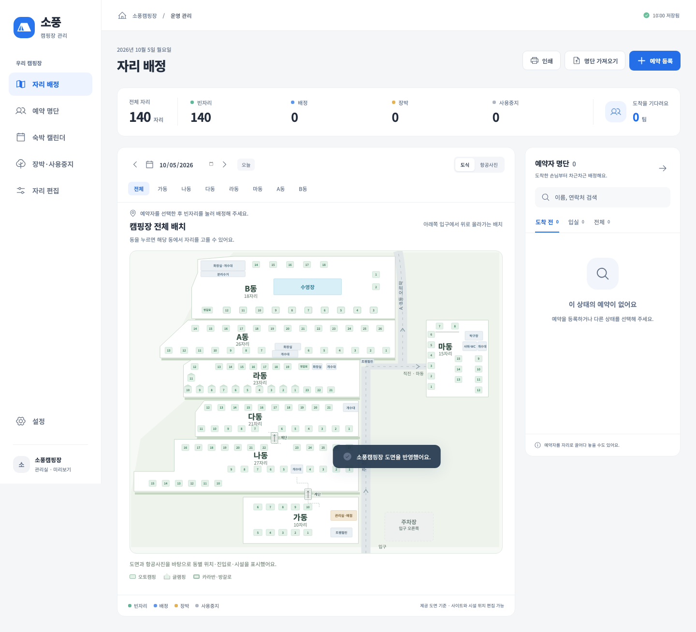
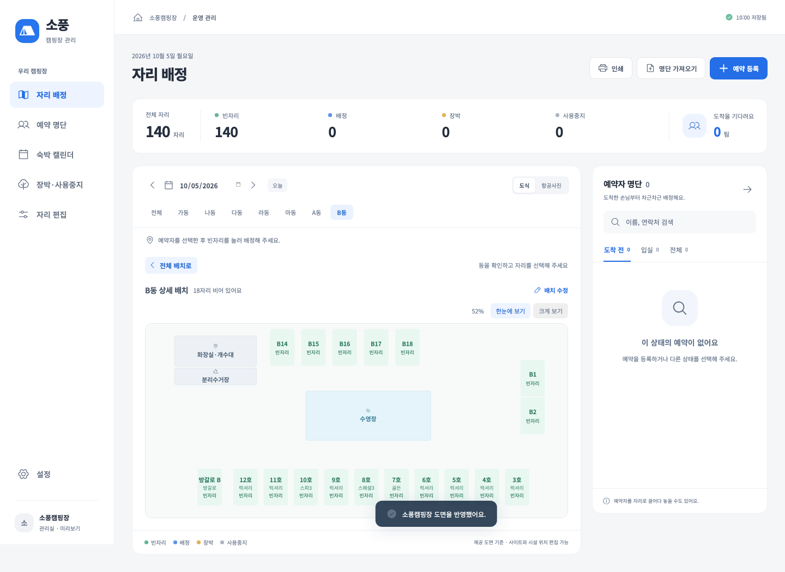

# 사용자 도면·시설·동 상세 반영

2026-10-05 · 버전 0.1.5

사용자가 제공한 [하단 도면](reference/user-plan-2026-10-05-lower.png)과 [상단 도면](reference/user-plan-2026-10-05-upper.png)을 앱에 반영했다. ‘장박’ 표시는 무시하고 가려진 번호를 연번으로 복원하라는 최신 지시를 따른다. 장박·사용중지는 생성하지 않으며 사용자가 직접 기간과 이름을 등록한다.

## 화면 사용법

1. 첫 설정 후 **소풍캠핑장 도면 적용**을 누른다. 체험 중이라면 예시 예약·장박 제거를 확인한 후 운영 도면으로 전환한다. 기존 운영 데이터에는 자리 ID와 예약·장박 연결을 보존하며 도면을 합친다.
2. **자리 배정**의 기본 화면에서 전체 구역 배치를 본다. 아래부터 가→나→다→라→A→B로 올라가며 마동은 라동 오른쪽 도로 건너편이다.
3. 예약자를 선택하고 원하는 동을 클릭한다. 해당 동의 상세 배치에서 시설·객실 종류를 확인하고 빈자리를 누른 뒤 **배정하고 입실**한다. 실제 숙박 기간 전체의 충돌을 확인한다.
4. **전체 배치로**를 누르면 구역 선택 화면으로 돌아간다. 동을 오가도 선택한 손님과 날짜는 유지한다. 상단 동 버튼으로 직접 전환할 수도 있다.
5. **한눈에 보기 / 크게 보기**로 배치를 확인한다. 세로로 긴 도면은 페이지 높이에 맞춰 잘리지 않게 표시하며 확대 시 도면 내부를 스크롤한다.
6. **배치 수정** 또는 **자리 편집 → 동별 배치**에서 사이트·시설 위치를 각각 수정한다. 드래그·클릭·방향키 이동·되돌리기·격자 정렬을 지원하며 자동 저장한다. 항공사진 좌표는 별도다.

## 반영한 자리와 시설

| 동 | 자리 | 구성 | 시설 |
|---|---:|---|---|
| 가 | 10 | 가1–10 오토 | 매점 건물, 트램펄린 |
| 나 | 27 | 나1–27 오토, 왼쪽 아래로 꺾인 줄 | 개수대 |
| 다 | 21 | 다1–21 오토, 두 줄 | 개수대 |
| 라 | 23 | 라1–11 글램핑, 라12–19·21–23 오토, 방갈로 A | 화장실, 개수대 |
| 마 | 15 | 마1–15 오토, 좌·중·우 열 | 탁구장, 샤워실·화장실, 개수대 |
| A | 26 | A1–26 오토, 하단 가운데 시설 | 화장실, 개수대 |
| B | 18 | B1·2·14–18 오토, 카라반3–12, 방갈로 B | 화장실·개수대, 분리수거장, 수영장 |
| 합계 | **140** | 오토117·글램핑11·카라반10·방갈로2 | **14개 시설 객체** |

카라반 3·4·5·6·9·11·12호는 **럭셔리**, 7호는 **골든**, 8호는 **스페셜3**, 10호는 **스파3**다. 자리 상세와 자리 목록에도 유형을 표시하며 자리 수정에서 세부 유형을 바꿀 수 있다. 방갈로 A는 라동에 있고 물리 A동과 다르다. 도면에 없는 라20·B13 명칭을 임의로 부여하지 않았다.

라동은 하단 오른쪽에서 왼쪽으로 글램핑1–10, 왼쪽 세로에 11, 상단 왼쪽에 12를 놓았다. 하단 오른쪽의 가려진 두 칸은 글램핑1 다음부터 라23·22·21 순으로 배치했다. A동은 윗줄14–26, 아랫줄13–7과 시설을 사이에 둔6–1이다. B동의 윗줄14–18과 오른쪽1·2는 오토이며 아래 카라반 호수와 분리한다.

도면은 상대 위치를 표현한다. 실측 거리·방향이나 항공사진 좌표를 확정한 것은 아니다. 무번호 추가 칸은 새 사이트로 등록하지 않았다.

## 데이터 보존

- 기존 자리와 동·이름이 같으면 기존 ID를 사용하고 예약·배정·블록 및 항공사진 좌표를 보존한다. 사용자 추가 자리도 삭제하지 않는다.
- 기존 사용 중 자리의 유형을 바꿔야 하는 충돌이나 중복 식별이 있으면 도면 반영 전체를 취소하고 오류를 표시한다.
- 시설 위치와 사이트 위치는 독립 저장하고 각각 되돌리기를 지원한다. 시설을 이동해도 손님 배정은 바뀌지 않는다.
- `Site.detail`, `State.facilities`, `State.sitePlan`은 선택 필드다. 해당 필드가 없는 기존 version 1 백업도 읽는다.

현재 Mac의 기존 운영 자료는 원본 백업 후 적용했다. 가1–가4의 기존 ID를 보존해 140자리·14시설로 확장했으며 예약·배정·장박 0건을 그대로 유지했다. 원본은 사용자 데이터 폴더의 `before-site-plan-2026-10-05T04-48-34-576Z.json`에 보관했다. 저장 후 파일을 다시 읽어 도면과 기존 자료의 보존을 확인했다.

## 캠핏 연결 상태

사용자는 현재 캠핏으로만 예약을 받으며 사업자 계정을 가지고 있다. 지금은 로그인하지 않고 앱 완성 후 Windows 설치 PC에서 직접 로그인하기로 했다. **설정 → 캠핏 로그인** 창을 제공하고 신규 예약의 기본 경로를 캠핏으로 바꿨다. 과거 경로 기록은 보존한다.

로그인 창은 별도 세션이며 로컬 예약 파일에 접근할 수 없다. 앱 잠금 시 해당 창도 종료한다. 실제 캠핏 인증·예약 조회 화면·내보내기 규격은 아직 확인하지 않았다. **예약 자동 가져오기는 미구현**이며 현재 CSV/XLSX 수동 가져오기를 사용한다. 로그인 창 추가와 자동 수집 완료를 혼동하지 않는다.

## 검증

- TypeScript·제품 빌드 통과, 자동 테스트 44개 통과.
- 브라우저 기능 테스트 30개 통과. 전체 → B동 → 전체 → A동 이동 중 손님·날짜 보존과 실제 배정, 140자리·14시설·카라반 유형, 시설 이동·되돌리기·새로고침, 960px·390px 가로 넘침 없음 포함.
- 인쇄에 전체 자리와 시설이 포함되며 세로로 긴 마동은 도면 높이 160mm 이내로 제한. 조정 후 관련 4개 UI 테스트 통과.
- Mac Electron 22 / Chromium 108에서 기존 저장·백업·복원·잠금·조기 입실과 함께 실도면 병합·기존 예약 보존·시설 이동 저장 통과.
- 캠핏 창은 테스트용 로컬 응답으로 Node·파일 브리지 분리와 잠금 시 창 종료를 검증했다. 실제 사업자 로그인이나 예약 조회가 성공했다는 뜻은 아니다.
- Windows x64·ia32 통합 설치 파일 생성 완료. 두 실행 파일의 PE 아키텍처와 버전 0.1.5, 각 패키지 안 `dist`·`electron` 133개 파일의 원본 일치를 확인했다. **실제 Windows 8·8.1·10·11 설치·실행은 아직 미검증**이다.

설치 파일: [Sopung-Camp-Setup-0.1.5.exe](../release/Sopung-Camp-Setup-0.1.5.exe), 144,472,626바이트. SHA-256은 [검증값 파일](../release/Sopung-Camp-Setup-0.1.5.exe.sha256)에 기록했다.

구현: `src/sitePlan.ts`, `src/PlanFeatures.tsx`, `src/AreaLayout.tsx`, `src/domain.ts`, `src/App.tsx`, `electron/camfit.cjs`. 테스트: `tests/sitePlan.test.ts`, `tests/ui/sitePlan.spec.ts`, `tests/desktop.cjs`.
