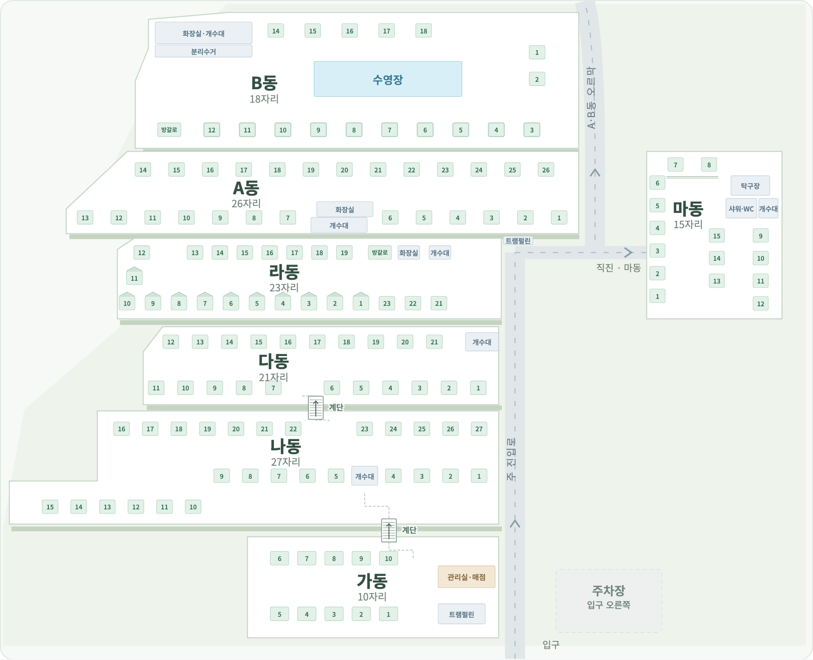
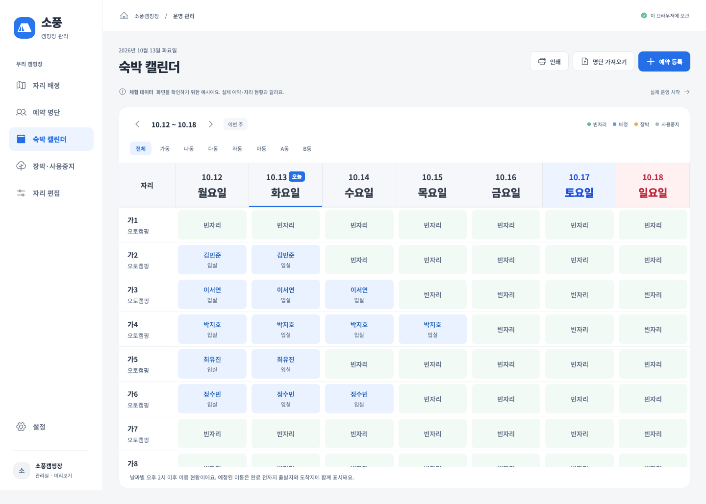

# 계단·진입로·주간 캘린더·종료 버튼

2026-10-06 · 0.1.8

아래 내용은 0.1.8의 기록이다. 최신 전체 지도 이미지는 추가 트램펄린과 단차 선과 도로 모서리 정렬을 반영한 0.1.11로 갱신했으며 [추가 정정](site-additions-2026-10-06.md)을 따른다.

사용자의 추가 현장 설명과 항공사진(Q58–Q60)을 반영했다. 이전의 길고 비스듬한 계단 그림을 같은 크기의 짧은 평면 계단으로 바꿨다. 계단 본체에는 단과 진행 화살표를 표시하고 접근 통로는 옅은 직각 선으로 구분한다. 다6·7 ↔ 나22·23, 나4·5 ↔ 가10 오른쪽이라는 위치는 유지한다.

라동 개수대 옆 높이에서 오른쪽으로 이동해 A·B동으로 올라가거나 마동으로 직진하도록 갈림길을 올렸다. 오른쪽 이동 구간을 넓히고 상부 구역·진입로 폭을 함께 맞췄다. 마동은 A동·라동 높이를 유지한다. [개수대 옆 길 설명](reference/user-ra-sink-road-2026-10-06.png), [추가 항공사진](reference/user-aerial-2026-10-06.png)은 상대 위치 대조 자료이며 실측 좌표나 현재 점유 자료가 아니다.

예약·배정·장박·시설 등록과 PIN을 바꾸지 않는다. 표시용 전체 지도만 수정하므로 운영 JSON 마이그레이션이 필요 없다. 상세·편집·인쇄의 기존 계단 표시는 유지한다.

캘린더는 선택한 날짜가 포함된 **월요일~일요일**을 표시한다(Q62). 이전·다음 주도 월요일 기준으로 움직이고 ‘이번 주’는 오늘이 포함된 월~일로 돌아간다. 연도 경계·일요일·화요일 시작을 검사했다.

설치 앱의 왼쪽 아래와 잠금 화면에 **프로그램 종료** 버튼을 넣었다(Q63). 저장 중에는 비활성화하며 IPC 응답을 반환한 뒤 앱을 종료한다. 브라우저 미리보기에는 앱 종료 버튼을 표시하지 않는다.

TypeScript·제품 빌드·형식 검사, 운영 테스트 49개·UI 32개를 통과했다. Mac Electron 22에서 종료 버튼으로 프로세스가 닫힘을 확인했다. 전체 지도와 상세의 계단·자리·시설 표시, 960px·390px에서 가로 넘침 없이 탐색하는 동작을 확인했다. 캠핏 동기화 검증 범위는 [별도 기록](camfit-sync-2026-10-06.md)을 따른다. Windows 실기기 설치·실행은 미검증이다.
